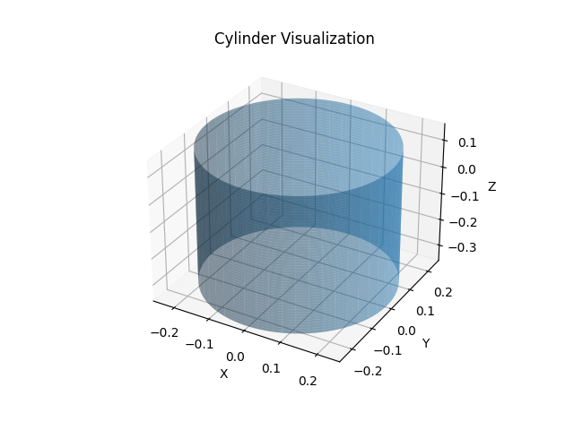

# Changelog

## v0.6 (2026-11-20): nerfstudio 1.1.5 port, custom data, export

- Ported to nerfstudio 1.1.5 and gsplat 1.4.0. `ESplatfactoModel` subclasses nerfstudio's `SplatfactoModel` and overrides only the event-specific parts (two renders per event window, both feeding densification; event loss; bound clipping; dataset background), so `esplatfacto.py` shrinks from 1043 to 310 lines and `ns-export gaussian-splat` accepts the model. Densification uses gsplat's `DefaultStrategy` with the 3DGS thresholds; Splatfacto's pause of `num_train_data` steps after each opacity reset and its training-time clamp are still disabled. Over seeds 42, 1, 2: lego 29.14 ± 0.08 dB / LPIPS 0.045 (v0.5 stack: 28.91 ± 0.16 / 0.048), drums 30.97 ± 0.02 dB / 0.040 (30.89 ± 0.08 / 0.040), about 8% fewer Gaussians, same off-orbit opacity; sewing (real) keeps its off-orbit opacity (0.14-0.16). README figures are regenerated from the ported models.
- Custom data (`dataloader.py`, [docs/CUSTOM_DATA.md](docs/CUSTOM_DATA.md)): sensor size (`--width/--height`), intrinsics from `intrinsics.txt` or `--fx/--fy/--cx/--cy`, non-uniform pose times from `timestamps.txt`, pose world up-axis (`--world-up`), and `--normalize` to bring any capture to the scale the model's thresholds assume. Input checks for event coordinates, polarities, pose matrices and timestamp units. With explicit intrinsics, `--type` selects only the event settings. EventNeRF scenes preprocess to identical `transforms.json` files as before.
  Tested end to end: lego rewritten as a custom recording (z-up world, scaled 2.5x and shifted, microsecond timestamps, explicit intrinsics) trains to 28.99 dB, within seed noise of the original (28.91 ± 0.16 dB).
- `scripts/export_ply.py`: standard 3DGS `.ply` export.
- `scripts/reproduce.sh`: trains and evaluates lego, drums and sewing and prints the results table (a fresh run gave lego 28.95 dB, drums 30.95 dB).
- README results are now mean ± std over 4 runs: lego 28.91 ± 0.16 dB, drums 30.89 ± 0.08 dB.
- `scripts/make_orbit_gif.py`: reads frame times and sensor size from `transforms.json`.

## v0.5 (2026-11-20): official training recipe

The training recipe follows the [official Event3DGS implementation](https://github.com/tyxiong23/Event3DGS). The haze left in v0.4 came from splatfacto defaults that do not fit event data:

1. Densification was gated by splatfacto's "every image seen since the last opacity reset" rule. Every one of the 1001 frames is a training camera, so densification and opacity pruning were off for 1100 of every 3000 steps (and before step 1200). It now runs every 100 steps from step 500 to 15k, as in 3DGS.
2. The training render was clamped at 1.0, which zeroed the event-loss gradient of every saturated pixel. The clamp now applies at evaluation only.
3. Culling thresholds were splatfacto's (world size 0.5, screen radius ~52 px, screen-size culling until step 4k), loose enough for blobs larger than the object to survive as background-coloured haze. They are now the 3DGS values: 0.1 x camera extent, 20 px, until step 15k.
4. The loss was MSE on the channel-summed event map. It is now the official L1 + 0.2 D-SSIM on the Bayer-masked three-channel maps, on a random 70% of pixels per step, which also restores the scale the 3DGS densification threshold (2e-4) was tuned for.
5. An unused v0.32 preprocessing class that imported `bm4d` / `colour_demosaicing` is removed.

Effect of each change on lego (single seed): the culling thresholds give most of the PSNR gain (25.9 to 28.8 dB) and cut off-orbit opacity about 3x; the L1 + D-SSIM loss raises the Gaussian count from 6.5k to 209k and lowers LPIPS from 0.087 to 0.049.

| Scene | v0.4 | v0.5 |
|---|---|---|
| lego | 25.70 / 0.938 / 0.067 | 28.81 / 0.939 / 0.049 |
| drums | 25.81 / 0.954 / 0.057 | 30.82 / 0.952 / 0.040 |

## v0.4 (2026-11-20): event supervision

The floaters of v0.32 came mostly from how events were turned into supervision:

1. Event frames were min-max rescaled to 0-255, so pixels without events got a target of ~0.5 (lego) / ~0.3 (sewing) instead of 0, with a different offset and gain per frame. Targets are now `C * (signed event count + polarity offset)`.
2. The loss compared the linear RGB difference of the two renders; events measure the change of log intensity. It now differences `log(rgb^2.2 + eps)`, as in EventNeRF.
3. The two renders of a pair each drew their own random background, so every background pixel of the difference was noise. Both now use the dataset background (159/255).
4. `dataloader.py` hard-coded `is_real=True`, so synthetic scenes got the real camera's focal length (389.25 instead of 480.55).
5. Random init filled a [-5,5]^3 cube although the cameras sit at radius ~1, and nothing removed Gaussians outside the object. Init now samples the scene bound, estimated from event activity, and Gaussians leaving it are made invisible and culled (Density Clipping, EventNeRF A.2).
6. The t0 cameras were re-oriented, re-centred and re-scaled separately from the t cameras, shifting the same camera by a few pixels between the two renders being differenced.
7. The event map was demosaiced instead of masking the loss per pixel with the RGGB pattern; densification used only the t0 render's gradients; event windows were off by one frame and fixed once per frame; training crashed at step 1000; the pipeline did not subclass nerfstudio's `Pipeline`, so `ns-viewer` / `ns-render` refused trained models.

  
  
Density Clipping from the EventNeRF paper

## v0.32 (2024-11-08)

First public release.
