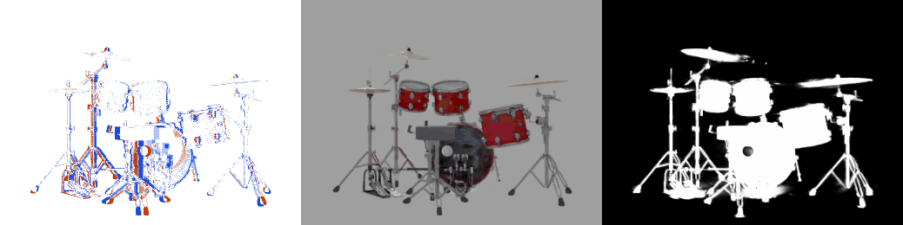

# ESplat: Event Camera 3D Gaussian Splatting

Train 3D Gaussian Splatting from event-camera data, as a [nerfstudio](https://docs.nerf.studio/) method. ESplat is an unofficial implementation of [Event3DGS (CoRL 2024)](https://arxiv.org/abs/2406.02972); the official code is [tyxiong23/Event3DGS](https://github.com/tyxiong23/Event3DGS). Data follows the [EventNeRF](https://github.com/r00tman/EventNeRF) format.

<div align="center">

<p>Drums, trained from events only. Left: input events (orange ON, blue OFF). Middle: render. Right: opacity.</p>
</div>

## Updates

- **2026-11-20, v0.5:** training recipe aligned with the official Event3DGS implementation; background haze removed. Lego 28.81 dB, drums 30.82 dB PSNR.
- **2026-11-20, v0.4:** fixed the event-supervision bugs behind the v0.32 floaters.
- **2024-11-08, v0.32:** first public release.

Details in [CHANGELOG.md](CHANGELOG.md).

## Quickstart

With the [environment installed](#installation), the sample scenes in `data/` run directly:

```
python dataloader.py -p data -s drums
ns-train esplatfacto --data data/drums/output --experiment-name drums --vis viewer+tensorboard
```

Open the viewer at `http://localhost:7007` while it trains. On an RTX PRO 6000, 30k iterations take about 3 minutes with `--vis tensorboard` and about 8 with the viewer attached.

## Results

Renders from three training-ring poses (top) and their opacity (bottom; black is empty space, so haze would show as grey), after 30k iterations.

| Lego (synthetic) | Drums (synthetic) |
|---|---|
|  |  |

| Sewing (real) |
|---|
|  |

PSNR / SSIM / LPIPS on the 99 EventNeRF ground-truth views (log-affine colour alignment, single seed):

| Scene | ESplat v0.5 | EventNeRF renders, same metric |
|---|---|---|
| lego | **28.81 / 0.939 / 0.049** | 25.82 / 0.893 / 0.137 |
| drums | **30.82 / 0.952 / 0.040** | 28.43 / 0.924 / 0.057 |

Off-orbit (±30°) mean opacity is 0.35-0.39 on lego and 0.24-0.26 on drums. The lego baseplate stays translucent from above because every training camera is level with it. `scripts/reproduce.sh` regenerates this table.

## ESplat and the official Event3DGS

| | [Official Event3DGS](https://github.com/tyxiong23/Event3DGS) | ESplat |
|---|---|---|
| Codebase | original 3DGS rasterizer | nerfstudio plugin (gsplat) |
| Viewer, `ns-render`, nerfstudio configs | - | yes |
| Progressive training, RGB appearance refinement | yes | - |
| Training recipe (densification, culling, L1 + 0.2 D-SSIM loss) | reference | same |
| Event window | fixed at load, events in [T_j, T_i) | resampled every step, events in (T_j, T_i] |
| Initialisation | random cube | scene bound estimated from events |
| Default tonemap | log(I + eps) | log(I^2.2 + eps), as EventNeRF; `event-gamma 1.0` gives the official one |

The event binning is kept where measurements favour it: accumulating a window's events as (T_j, T_i] predicts the recorded events from consecutive GT views clearly better than [T_j, T_i) (Pearson r 0.870 vs 0.793 on lego, 0.911 vs 0.811 on drums).

# Installation

Tested on Linux with Python 3.10, torch 2.8.0 (CUDA 12.8), nerfstudio 1.0.3 and gsplat 0.1.10:

```
git clone https://github.com/jayhsu0627/Event3DGS && cd Event3DGS
conda create -n esplat python=3.10 pip -y && conda activate esplat
pip install -r requirements.txt
pip install -e .
```

gsplat 0.1.10 compiles its CUDA kernels on first use, so `nvcc` must be on `PATH` and `CUDA_HOME` set. On Blackwell GPUs set `TORCH_CUDA_ARCH_LIST=12.0`. `environment.yml` is the original Windows (Python 3.9, CUDA 11.8) environment.

`ns-train -h` should list `esplatfacto`, `esplatfacto-big` and `esplatfacto-lite`.

# Usage

## Data

The sample scenes in `data/` are extracted from EventNeRF; the full datasets are in EventNeRF's `data.tar.gz` ([download](https://github.com/r00tman/EventNeRF#data)).

```
data
├── ex2_events_viz.ipynb
├── drums
│   ├── events.npz
│   └── pose/
├── lego
│   ├── test_lego1_color_init159_1e-6eps.npz
│   └── pose/
└── sewing
    ├── b10_cal1_45rpm_gfox_eonly-2022_05_12_01_17_04_shift_ts1.npz
    └── pose/
```

Each scene needs exactly one event `.npz` (arrays `x`, `y`, `t`, `p`) and one OpenCV camera-to-world pose per frame in `pose/`, uniformly spaced in time over the event stream. `ex2_events_viz.ipynb` visualises the events. [](https://colab.research.google.com/github/jayhsu0627/Event3DGS/blob/main/data/ex2_events_viz.ipynb)

`dataloader.py` writes a nerfstudio folder `data/<scene>/output/`: `transforms.json` (intrinsics, poses, and an `events` block with the event file, contrast threshold, polarity offset, window size and an estimated scene bound) plus `images/` previews used only as viewer thumbnails. Synthetic vs. real data is auto-detected and selects the EventNeRF settings (focal 480.55 / 389.25, threshold 0.25 / 0.1, window 50 / 100).

```
python dataloader.py -p data -s lego
python dataloader.py -p data -s drums
python dataloader.py -p data -s sewing --polarity-offset -0.375   # EventNeRF's per-scene offset (chick: -0.438)
```

Useful flags: `--bound {auto,eventnerf,none,"r,z_min,z_max"}`, `--event-threshold`, `--tonemap-eps`, `--max-winsize`, `--monochrome`, `-o <output dir>`.

## Train

```
ns-train esplatfacto --data data/lego/output --experiment-name lego
```

Training runs 30k iterations. Always pass `--experiment-name`: every preprocessed scene folder is called `output`, so default run names collide. Add `--vis viewer+tensorboard` for the browser viewer (forward port 7007 when training remotely).

| Model option | Meaning |
|---|---|
| `--pipeline.model.event-threshold` | contrast threshold C |
| `--pipeline.model.tonemap-eps`, `--pipeline.model.event-gamma` | tonemap `log(I^gamma + eps)` |
| `--pipeline.model.event-loss {l1,mse}`, `--pipeline.model.ssim-lambda` | event loss (default L1 + 0.2 D-SSIM) |
| `--pipeline.model.rand-ratio` | fraction of pixels in the loss each step (default 0.7) |
| `--pipeline.model.clip-to-bound {True,False}` | cull Gaussians outside the scene bound |
| `--pipeline.model.opacity-reg` | L1 opacity penalty (default 0) |
| `--pipeline.model.background-color {dataset,random,black,white}` | training background (default: dataset grey 159/255) |

With torch >= 2.6, nerfstudio 1.0.3 cannot load its own checkpoints. Prefix viewer and render commands with `TORCH_FORCE_NO_WEIGHTS_ONLY_LOAD=1`, e.g. `TORCH_FORCE_NO_WEIGHTS_ONLY_LOAD=1 ns-viewer --load-config outputs/lego/esplatfacto/<timestamp>/config.yml`.

## Evaluate

EventNeRF's `comp_data.zip` (382 MB, from the [EventNeRF data share](https://github.com/r00tman/EventNeRF#data)) holds ground-truth views `<scene>/gt/r_XXXXX.png` at training poses for the synthetic scenes. `scripts/eval_gt.py` renders the model at those poses, applies EventNeRF's per-channel log-affine colour alignment (events only determine log-intensity changes), and reports PSNR / SSIM / LPIPS. It also renders an orbit tilted ±30° off the training ring with opacity maps, where floaters show up.

```
python scripts/eval_gt.py --load-config outputs/lego/esplatfacto/<timestamp>/config.yml \
    --gt-dir comp_data/lego/gt --out eval/lego
```

It writes `metrics.json`, `orbit_grid.png` and `gt_compare/`. To train and evaluate all three scenes and print the results table:

```
COMP_DATA=/path/to/comp_data bash scripts/reproduce.sh
```

`scripts/make_orbit_gif.py --load-config <config.yml> --out <file.gif>` makes the orbit animation at the top of this page.

# Known issues and TODOs

- [ ] `ns-export gaussian-splat` fails with `assert isinstance(pipeline.model, SplatfactoModel)`, because the model is an `ESplatfactoModel`. Fix: accept it in `ExportGaussianSplat` in nerfstudio's `exporter.py`.
- [ ] Real scenes use focal 389.25 with a centred principal point; EventNeRF's calibration files (with distortion) are not used yet.
- [ ] Split the RGB channels into independent 3DGS.
- [ ] Estimate t0 and t in preprocessing.
- [ ] Unstable background (grey) colouring in preprocessing.

# Acknowledgements

This repo started as a course project for CMSC 848B (Computational Imaging) at the University of Maryland.

- [Event3DGS](https://github.com/tyxiong23/Event3DGS), the official implementation, for the training recipe.
- [EventNeRF](https://github.com/r00tman/EventNeRF) for the datasets, ground truth and event model. The sample data in `data/` comes from EventNeRF.
- [nerfstudio](https://github.com/nerfstudio-project/nerfstudio) and [gsplat](https://github.com/nerfstudio-project/gsplat).
- The README template is borrowed from [LERF](https://github.com/kerrj/lerf); the event visualiser notebook from [events_viz](https://github.com/tub-rip/events_viz/).

# Citation

If you find this useful, please cite the Event3DGS paper:

```bibtex
@inproceedings{xiong2024event3dgs,
  title={Event3DGS: Event-based 3D Gaussian Splatting for High-Speed Robot Egomotion},
  author={Xiong, Tianyi and Wu, Jiayi and He, Botao and Fermuller, Cornelia and Aloimonos, Yiannis and Huang, Heng and Metzler, Christopher},
  booktitle={8th Annual Conference on Robot Learning},
  year={2024}
}
```
