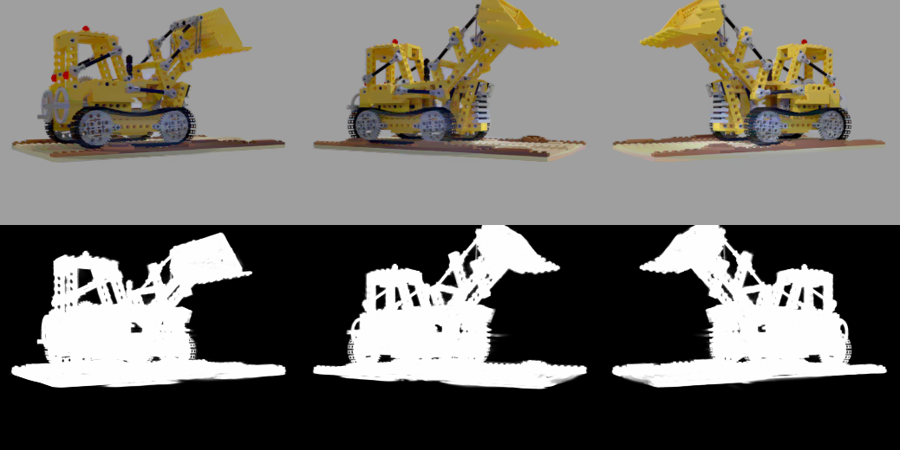
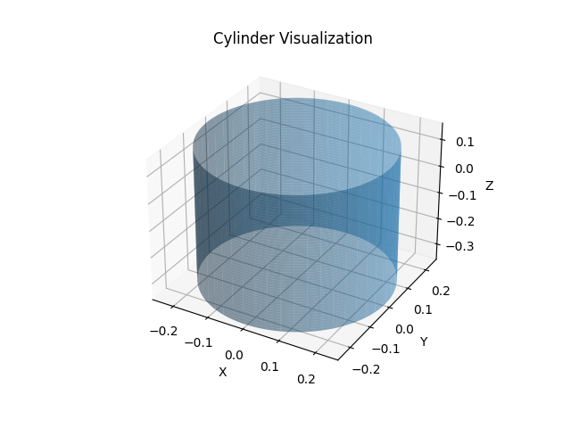

# ESplat: Event Camera 3D Gaussian Splatting

An unofficial [nerfstudio](https://docs.nerf.studio/) implementation of [Event3DGS: Event-based 3D Gaussian Splatting for High-Speed Robot Egomotion (CoRL 2024)](https://arxiv.org/abs/2406.02972). The official implementation is [tyxiong23/Event3DGS](https://github.com/tyxiong23/Event3DGS). This repo started as a course project for CMSC 848B (Computational Imaging) at the University of Maryland and trains 3DGS from event-camera data in the [EventNeRF](https://github.com/r00tman/EventNeRF) format.

<div align='center'>

</div>

## Updates

- **2026-11-20, v0.5:** training recipe aligned with the official Event3DGS implementation (densification schedule, culling thresholds, L1 + D-SSIM loss); background haze removed. Lego 28.81 dB, drums 30.82 dB PSNR. See [Changes](#changes).
- **2026-11-20, v0.4:** fixed the event-supervision bugs behind the v0.32 floaters (event targets, log-intensity loss, background, focal length, scene bound).
- **2024-11-08, v0.32:** first public release.

## Results (v0.5)

Renders from three training-ring poses (top) and their accumulated opacity (bottom; black is empty space, so haze would show as grey), after 30k iterations.

| Lego (synthetic) | Drums (synthetic) |
|---|---|
|  |  |

| Sewing (real) |
|---|
|  |

PSNR / SSIM / LPIPS on the 99 EventNeRF ground-truth views (`scripts/eval_gt.py`, log-affine colour alignment):

| Scene | v0.4 | v0.5 | EventNeRF renders, same metric |
|---|---|---|---|
| lego | 25.70 / 0.938 / 0.067 | **28.81 / 0.939 / 0.049** | 25.82 / 0.893 / 0.137 |
| drums | 25.81 / 0.954 / 0.057 | **30.82** / 0.952 / **0.040** | 28.43 / 0.924 / 0.057 |

Off-orbit (±30°) mean opacity fell from 0.82-0.84 to 0.35-0.39 on lego and from 0.56-0.62 to 0.24-0.26 on drums. The lego baseplate stays translucent from above because every training camera is level with it.

# Installation

ESplat is a nerfstudio method plugin ([guide](https://docs.nerf.studio/developer_guides/new_methods.html)) for `nerfstudio==1.0.3` and `gsplat==0.1.10`.

```
git clone https://github.com/jayhsu0627/Event3DGS
cd Event3DGS
```

Tested on Linux with Python 3.10, torch 2.8.0 (CUDA 12.8), nerfstudio 1.0.3 and gsplat 0.1.10:

```
conda create -n esplat python=3.10 pip -y && conda activate esplat
pip install torch==2.8.0 torchvision==0.23.0 --index-url https://download.pytorch.org/whl/cu128
pip install nerfstudio==1.0.3 "numpy<2" ninja "setuptools<81"
pip install gsplat==0.1.10
pip install -e .
```

gsplat 0.1.10 compiles its CUDA kernels on first use, so `nvcc` must be on `PATH` (and `CUDA_HOME` set). On Blackwell GPUs set `TORCH_CUDA_ARCH_LIST=12.0`. `environment.yml` is the original Windows (Python 3.9, CUDA 11.8) environment.

Run `ns-train -h`: the subcommands should include `esplatfacto`, `esplatfacto-big` and `esplatfacto-lite`.

# Usage

## Data

The sample scenes in `data/` are extracted from EventNeRF; the full datasets are in EventNeRF's `data.tar.gz` ([download](https://github.com/r00tman/EventNeRF#data)).

```
data
├── ex2_events_viz.ipynb
├── drums
│   ├── events.npz
│   └── pose/
├── lego
│   ├── test_lego1_color_init159_1e-6eps.npz
│   └── pose/
└── sewing
    ├── b10_cal1_45rpm_gfox_eonly-2022_05_12_01_17_04_shift_ts1.npz
    └── pose/
```

Each scene needs exactly one event `.npz` (arrays `x`, `y`, `t`, `p`) and one OpenCV camera-to-world pose per frame in `pose/`, uniformly spaced in time over the event stream (EventNeRF convention). `ex2_events_viz.ipynb` visualises the events. [](https://colab.research.google.com/github/jayhsu0627/Event3DGS/blob/main/data/ex2_events_viz.ipynb)

`dataloader.py` writes a nerfstudio folder `data/<scene>/output/`: `transforms.json` (intrinsics, one pose per frame, and an `events` block with the event file, contrast threshold, polarity offset, window size and an estimated scene bound) plus `images/` previews used only as viewer thumbnails. Event windows are accumulated on the fly during training. Synthetic vs. real data is auto-detected and selects the EventNeRF settings (focal 480.55 / 389.25, threshold 0.25 / 0.1, window 50 / 100).

```
python dataloader.py -p data -s lego
python dataloader.py -p data -s drums
python dataloader.py -p data -s sewing --polarity-offset -0.375   # EventNeRF's per-scene offset (chick: -0.438)
```

Useful flags: `--bound {auto,eventnerf,none,"r,z_min,z_max"}` (scene bounding cylinder; `auto` carves it from event activity), `--event-threshold`, `--tonemap-eps`, `--max-winsize`, `--monochrome`, `-o <output dir>`.

## Train

```
ns-train esplatfacto --data data/lego/output --experiment-name lego
```

Training runs 30k iterations. Always pass `--experiment-name`: every preprocessed scene folder is called `output`, so default run names collide. Add `--vis viewer+tensorboard` for the browser viewer at `http://localhost:7007` (forward the port when training remotely).

Event-specific model options (all have dataset-derived defaults):

| Option | Meaning |
|---|---|
| `--pipeline.model.event-threshold` | contrast threshold C |
| `--pipeline.model.tonemap-eps`, `--pipeline.model.event-gamma` | tonemap `log(I^gamma + eps)`; gamma 2.2 is EventNeRF's, 1.0 the official Event3DGS default |
| `--pipeline.model.event-loss {l1,mse}`, `--pipeline.model.ssim-lambda` | event loss (default L1 + 0.2 D-SSIM) |
| `--pipeline.model.rand-ratio` | fraction of pixels in the loss each step (default 0.7) |
| `--pipeline.model.clip-to-bound {True,False}` | cull Gaussians outside the scene bound |
| `--pipeline.model.opacity-reg` | L1 opacity penalty (default 0) |
| `--pipeline.model.background-color {dataset,random,black,white}` | training background (default: dataset grey 159/255) |

With torch >= 2.6, nerfstudio 1.0.3 cannot load its own checkpoints (`torch.load` defaults to `weights_only=True`). Prefix viewer and render commands with `TORCH_FORCE_NO_WEIGHTS_ONLY_LOAD=1`, e.g. `TORCH_FORCE_NO_WEIGHTS_ONLY_LOAD=1 ns-viewer --load-config outputs/lego/esplatfacto/<timestamp>/config.yml`.

## Evaluate against EventNeRF ground truth

EventNeRF's `comp_data.zip` (382 MB, from the [EventNeRF data share](https://github.com/r00tman/EventNeRF#data)) contains ground-truth views `<scene>/gt/r_XXXXX.png` at training poses for the synthetic scenes, and EventNeRF's own renders in `<scene>/event/`. `scripts/eval_gt.py` renders the model at those poses, applies EventNeRF's per-channel log-affine colour alignment (events only determine log-intensity changes), and reports PSNR / SSIM / LPIPS. It also renders an orbit tilted ±30° off the training ring with opacity maps, where floaters show up.

```
python scripts/eval_gt.py --load-config outputs/lego/esplatfacto/<timestamp>/config.yml \
    --gt-dir comp_data/lego/gt --out eval/lego
```

It writes `metrics.json`, `orbit_grid.png` and `gt_compare/`.

# Changes

### v0.5: official training recipe

The training recipe follows the [official Event3DGS implementation](https://github.com/tyxiong23/Event3DGS). The haze left in v0.4 came from splatfacto defaults that do not fit event data:

1. Densification was gated by splatfacto's "every image seen since the last opacity reset" rule. Every one of the 1001 frames is a training camera, so densification and opacity pruning were off for 1100 of every 3000 steps (and before step 1200). It now runs every 100 steps from step 500 to 15k, as in 3DGS.
2. The training render was clamped at 1.0, which zeroed the event-loss gradient of every saturated pixel. The clamp now applies at evaluation only.
3. Culling thresholds were splatfacto's (world size 0.5, screen radius ~52 px, screen-size culling until step 4k), loose enough for blobs larger than the object to survive as background-coloured haze. They are now the 3DGS values: 0.1 x camera extent, 20 px, until step 15k.
4. The loss was MSE on the channel-summed event map. It is now the official L1 + 0.2 D-SSIM on the Bayer-masked three-channel maps, on a random 70% of pixels per step, which also restores the scale the 3DGS densification threshold (2e-4) was tuned for.
5. An unused v0.32 preprocessing class that imported `bm4d` / `colour_demosaicing` is removed.

This version is a hybrid: the official training recipe, with this repo's event binning kept where measurements favour it. Accumulating a window's events as (T_j, T_i] instead of the official [T_j, T_i) predicts the recorded events from consecutive GT views clearly better (Pearson r 0.870 vs 0.793 on lego, 0.911 vs 0.811 on drums, same tonemap), and windows are resampled every iteration rather than fixed at load.

### v0.4: event supervision

The floaters of v0.32 came mostly from how events were turned into supervision:

1. Event frames were min-max rescaled to 0-255, so pixels without events got a target of ~0.5 (lego) / ~0.3 (sewing) instead of 0, with a different offset and gain per frame. Targets are now `C * (signed event count + polarity offset)`.
2. The loss compared the linear RGB difference of the two renders; events measure the change of log intensity. It now differences `log(rgb^2.2 + eps)`, as in EventNeRF.
3. The two renders of a pair each drew their own random background, so every background pixel of the difference was noise. Both now use the dataset background (159/255).
4. `dataloader.py` hard-coded `is_real=True`, so synthetic scenes got the real camera's focal length (389.25 instead of 480.55).
5. Random init filled a [-5,5]^3 cube although the cameras sit at radius ~1, and nothing removed Gaussians outside the object. Init now samples the scene bound, estimated from event activity, and Gaussians leaving it are made invisible and culled (Density Clipping, EventNeRF A.2).
6. The t0 cameras were re-oriented, re-centred and re-scaled separately from the t cameras, shifting the same camera by a few pixels between the two renders being differenced.
7. The event map was demosaiced instead of masking the loss per pixel with the RGGB pattern; densification used only the t0 render's gradients; event windows were off by one frame and fixed once per frame; training crashed at step 1000; the pipeline did not subclass nerfstudio's `Pipeline`, so `ns-viewer` / `ns-render` refused trained models.

<div align="center">
  
  <p>Density Clipping from the EventNeRF paper</p>
</div>

# Known issues and TODOs

- [ ] `ns-export gaussian-splat` fails with `assert isinstance(pipeline.model, SplatfactoModel)`, because the model is an `ESplatfactoModel`. Fix: accept it in `ExportGaussianSplat` in nerfstudio's `exporter.py`.
- [ ] Real scenes use focal 389.25 with a centred principal point; EventNeRF's calibration files (with distortion) are not used yet.
- [ ] Split the RGB channels into independent 3DGS.
- [ ] Estimate t0 and t in preprocessing.
- [ ] Unstable background (grey) colouring in preprocessing.

# Acknowledgements

- [Event3DGS](https://github.com/tyxiong23/Event3DGS), the official implementation, for the training recipe.
- [EventNeRF](https://github.com/r00tman/EventNeRF) for the datasets, ground truth and event model.
- [nerfstudio](https://github.com/nerfstudio-project/nerfstudio) and [gsplat](https://github.com/nerfstudio-project/gsplat).
- The README template is borrowed from [LERF](https://github.com/kerrj/lerf); the event visualiser notebook from [events_viz](https://github.com/tub-rip/events_viz/).

# Citation

If you find this useful, please cite the Event3DGS paper:

```bibtex
@inproceedings{xiong2024event3dgs,
  title={Event3DGS: Event-based 3D Gaussian Splatting for High-Speed Robot Egomotion},
  author={Xiong, Tianyi and Wu, Jiayi and He, Botao and Fermuller, Cornelia and Aloimonos, Yiannis and Huang, Heng and Metzler, Christopher},
  booktitle={8th Annual Conference on Robot Learning},
  year={2024}
}
```
