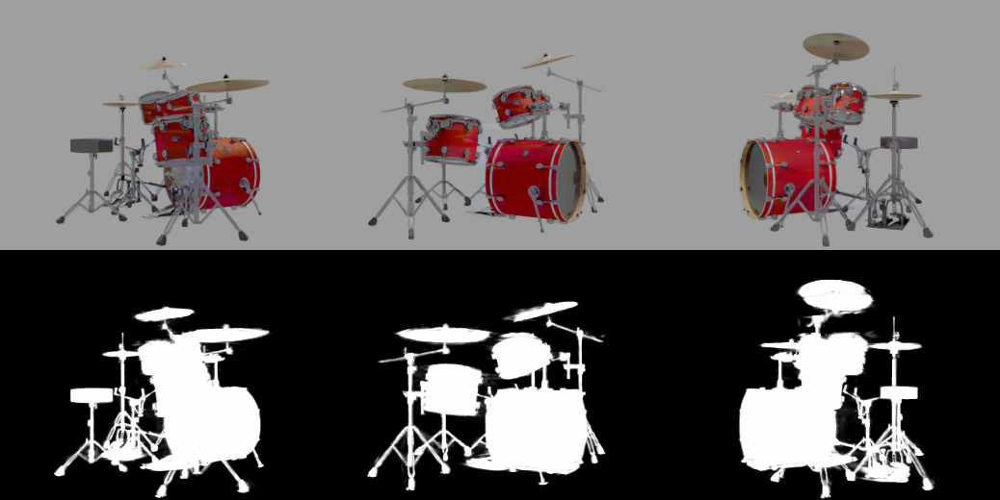
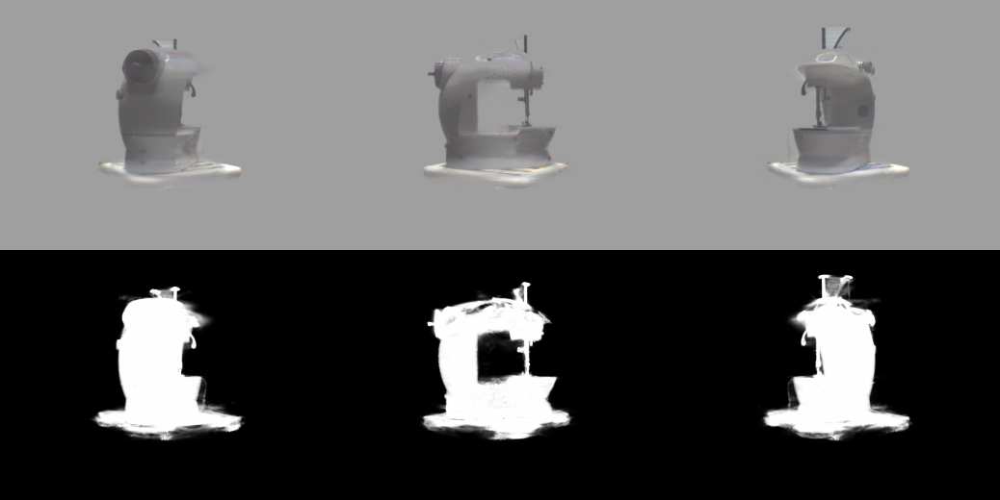

# ESplat: Event Camera 3D Gaussian Splatting
This is the unofficial implementation for [Event3DGS: Event-based 3D Gaussian Splatting for High-Speed Robot Egomotion
(CoRL 2024)](https://arxiv.org/abs/2406.02972). This work was completed as a course project in "CMSC 848B - Selected Topics in Information Processing: Computational Imaging" at the University of Maryland.


<div align='center'> 

</div>

We prepare this repo based on [nerfstudio](https://docs.nerf.studio/) and [EventNeRF](https://github.com/r00tman/EventNeRF), the idea was to train a 3D Gaussian Splatting for event camera data in the nerfstudio pipeline.

<div align='center'> 

</div>

# Installation
ESplat follows the integration guidelines described [here](https://docs.nerf.studio/developer_guides/new_methods.html) for custom methods within Nerfstudio. Update to `nerfstudio==1.0.3`.

<!-- ### 0. Install Nerfstudio dependencies
[Follow these instructions](https://docs.nerf.studio/en/latest/quickstart/installation.html) up to and including "tinycudann" to install dependencies and create an environment -->

### 1. Clone this repo
Give a star before you clone this repo please. [](https://github.com/jayhsu0627/Event3DGS/stargazers)


`git clone https://github.com/jayhsu0627/Event3DGS`

### 2. Install conda env

```
conda env create -f environment.yml
```

### 3. Install this repo as a python package
Navigate to this folder and run `python -m pip install -e .`

### 4. Reinstall gsplat to avoid this [issue](https://github.com/nerfstudio-project/nerfstudio/issues/2727)
Please check your gsplat version by `conda list` before you do this step.

`pip install git+https://github.com/nerfstudio-project/gsplat.git@v0.1.10`
<!-- ### 4. Run `ns-install-cli` -->

### Checking the install
Run `ns-train -h`: you should see a list of "subcommands" with esplatfacto, esplatfacto-big, and esplatfacto-lite included among them.

# Using ESplat
Now that ESplat is installed you can play with it! 

## Pre-process datasets
- Prepare datasets: If you interested the full datasets from EventNeRF, please follow [here](https://github.com/r00tman/EventNeRF) to download the desire datasets `data.tar.gz`. We also prepared a sample data extracted from EventNeRF.

```
data
│   ex2_events_viz.ipynb
│
├───drums
│       events.npz
|   \---pose
├───lego
│       test_lego1_color_init159_1e-6eps.npz
|   \---pose
├───sewing
|       b10_cal1_45rpm_gfox_eonly-2022_05_12_01_17_04_shift_ts1.npz
└───\---pose

```

Each scene needs exactly one event `.npz` (arrays `x`, `y`, `t`, `p`) and one OpenCV camera-to-world pose per frame in `pose/`, uniformly spaced in time over the event stream (EventNeRF convention).
- We also provided a jupyter notebook `ex2_events_viz.ipynb` for you to visualize the event camera data. [](https://colab.research.google.com/github/jayhsu0627/Event3DGS/blob/main/data/ex2_events_viz.ipynb)

- Preprocess: `dataloader.py` writes a nerfstudio folder `data/<scene>/output/` containing `transforms.json` (intrinsics, one pose per frame, and an `events` block with the event file path, contrast threshold, polarity offset, window size and an estimated scene bound) plus `images/` previews used only as viewer thumbnails. The event windows themselves are accumulated on the fly during training. Synthetic vs. real data is auto-detected and selects the EventNeRF settings (focal 480.55 / 389.25, threshold 0.25 / 0.1, window 50 / 100).

```
python dataloader.py -p data/ -s lego
python dataloader.py -p data/ -s drums
python dataloader.py -p data/ -s sewing --polarity-offset -0.375   # EventNeRF's per-scene offset (chick: -0.438)
```

Useful flags: `--bound {auto,eventnerf,none,"r,z_min,z_max"}` (scene bounding cylinder; `auto` carves it from event activity), `--event-threshold`, `--max-winsize`, `--monochrome`, `-o <output dir>`.

## Train

- Launch training with `ns-train esplatfacto --data <data_folder>` (30k iterations by default). For more details, see [Nerfstudio documentation](https://docs.nerf.studio/quickstart/first_nerf.html).

```
ns-train esplatfacto --data data/lego/output
```

Event-specific model options (all have dataset-derived defaults): `--pipeline.model.event-threshold`, `--pipeline.model.tonemap-eps`, `--pipeline.model.event-gamma` (2.2 = EventNeRF `log(I^2.2+eps)`, 1.0 = official Event3DGS `log(I+eps)`), `--pipeline.model.event-loss {l1,mse}`, `--pipeline.model.ssim-lambda`, `--pipeline.model.rand-ratio`, `--pipeline.model.clip-to-bound {True,False}`, `--pipeline.model.opacity-reg 0.01`, `--pipeline.model.background-color {dataset,random,black,white}`.

Always pass `--experiment-name <scene>`: every preprocessed scene folder is called `output`, so default run names collide.

## Evaluate against EventNeRF ground truth

EventNeRF's `comp_data.zip` (from the [EventNeRF data share](https://github.com/r00tman/EventNeRF#data)) contains ground-truth RGB views `<scene>/gt/r_XXXXX.png` at training poses for the synthetic scenes. `scripts/eval_gt.py` renders the model at those poses, applies EventNeRF's per-channel log-affine colour alignment (events only determine log-intensity *changes*), and reports PSNR / SSIM / LPIPS. It also renders an orbit tilted ±30° above/below the training ring together with the opacity (alpha) maps, which is where floaters show up.

```
python scripts/eval_gt.py --load-config outputs/output/esplatfacto/<timestamp>/config.yml \
    --gt-dir comp_data/lego/gt --out eval/lego
```

- Connect to the viewer by forwarding the viewer port (we use VSCode to do this), and click the link to `viewer.nerf.studio` provided in the output of the train script. Use the viewer running locally at: `http://localhost:7007`
- During training, you can use the crop scale in crop viewport to locate the noisy 3DGS model.


v0.5 results after 30k iterations: renders from three training-ring poses (top) and their accumulated opacity (bottom; black = empty space, so haze would show up as grey).

| Lego (synthetic) | Drums (synthetic) |
|---|---|
|  |  |

| Sewing (real) |
|---|
|  |


## Known Issues and TODOs

- [ ] The nerfstudio support pointcloud output once you trained a 3DGS, however, we can't make it here right now, since the nerfstudio will verify if the output class is a `SplatfactoModel` instance or not. Instead, we are a `ESplatfactoModel`. Idea: edit `class ExportGaussianSplat(Exporter)` in `exporter.py`.

```
  ns-export gaussian-splat --load-config outputs\plane\esplatfacto\2024-04-22_201709\config.yml --output-dir exports/ply`

  File "C:\Users\sjxu\AppData\Local\miniconda3\envs\event3dgs\lib\site-packages\nerfstudio\scripts\exporter.py", line 614, in entrypoint
    tyro.cli(Commands).main()
  File "C:\Users\sjxu\AppData\Local\miniconda3\envs\event3dgs\lib\site-packages\nerfstudio\scripts\exporter.py", line 536, in main
    assert isinstance(pipeline.model, SplatfactoModel)
AssertionError
```

- [x] Floaters. **This repo only contains a pure 3DGS implementation**, it's not the same as the CoRL 2024 paper or the EventNeRF paper. The floaters of v0.32 came mostly from bugs in how events were turned into supervision, fixed in v0.4:
  1. Event frames were min-max rescaled to 0-255, so pixels *without* events got a target of ~0.5 (lego) / ~0.3 (sewing) instead of 0, with a different offset and gain per frame. Targets are now `C * (signed event count + polarity offset)`.
  2. The loss compared the *linear* RGB difference of the two renders; events measure the change of *log* intensity. It is now `log(rgb^2.2 + eps)` differenced, as in EventNeRF.
  3. The two renders of a pair each drew their own random background, so every background pixel of the difference was noise. Both now use the dataset background (159/255).
  4. `dataloader.py` hard-coded `is_real=True`, so synthetic scenes got the real camera's focal length (389.25 instead of 480.55).
  5. Random init filled a [-5,5]^3 cube although the cameras sit at radius ~1, and nothing removed Gaussians outside the object. Init now samples the scene bound, and Gaussians leaving it are made invisible and culled (Density Clipping, A.2 of EventNeRF); the bound is estimated from event activity.
  6. The t0 cameras were re-oriented / re-centred / re-scaled separately from the t cameras, shifting the same camera by a few pixels between the two renders being differenced.
  7. The event map was demosaiced (hallucinated colours) instead of masking the loss per pixel with the RGGB pattern; densification only used gradients of the t0 render; event windows were off by one frame and fixed once per frame (now resampled every iteration); training crashed at step 1000 (`get_average_eval_image_metrics` assert); the pipeline did not subclass nerfstudio's `Pipeline`, so `ns-viewer --load-config` / `ns-render` refused trained models.

- [x] Haze and missing detail (v0.5). The training recipe now follows the [official Event3DGS implementation](https://github.com/tyxiong23/Event3DGS); the remaining v0.4 haze came from splatfacto defaults that do not fit event data:
  1. Densification was gated by splatfacto's "every image seen since the last opacity reset" rule. Every one of the 1001 frames is a training camera here, so densification and opacity pruning were off for 1100 of every 3000 steps (and before step 1200). It now runs every 100 steps from step 500 to 15k, as in 3DGS.
  2. The training render was clamped at 1.0, which zeroed the event-loss gradient of every saturated pixel. The clamp now applies at evaluation only.
  3. Culling thresholds were splatfacto's (world size 0.5, screen radius ~52 px, screen-size culling until step 4k), loose enough for blobs larger than the object to survive as background-coloured haze. They are now the 3DGS values: 0.1 x camera extent, 20 px, until step 15k.
  4. The loss was MSE on the channel-summed event map. It is now the official L1 + 0.2 D-SSIM on the Bayer-masked three-channel maps, on a random 70% of pixels per step (`rand-ratio`), which also restores the scale the 3DGS densification threshold (2e-4) was tuned for.
  5. A leftover v0.32 preprocessing class in the dataparser imported `bm4d` / `colour_demosaicing`; it was unused and is removed.

  This version is a hybrid: the official training recipe, with this repo's event binning kept where measurements favour it. Accumulating the events of a window as (T_j, T_i] instead of the official [T_j, T_i) predicts the recorded events from consecutive GT views clearly better (Pearson r 0.870 vs 0.793 on lego, 0.911 vs 0.811 on drums, under the same tonemap), and windows are resampled every iteration rather than fixed at load.

  Results at 30k iterations (PSNR / SSIM / LPIPS from `scripts/eval_gt.py`, log-affine colour alignment, 99 GT views):

  | Scene | v0.4 | v0.5 | EventNeRF renders, same metric |
  |---|---|---|---|
  | lego | 25.70 / 0.938 / 0.067 | **28.81 / 0.939 / 0.049** | 25.82 / 0.893 / 0.137 |
  | drums | 25.81 / 0.954 / 0.057 | **30.82** / 0.952 / **0.040** | 28.43 / 0.924 / 0.057 |

  Off-orbit (±30°) mean alpha fell from 0.82-0.84 to 0.35-0.39 on lego and from 0.56-0.62 to 0.24-0.26 on drums. The lego baseplate stays translucent from above because every training camera is level with it.

  Note: with torch >= 2.6, nerfstudio 1.0.3 cannot load its own checkpoints (`torch.load` now defaults to `weights_only=True`). Prefix viewer/render commands with `TORCH_FORCE_NO_WEIGHTS_ONLY_LOAD=1`, e.g. `TORCH_FORCE_NO_WEIGHTS_ONLY_LOAD=1 ns-viewer --load-config outputs/.../config.yml` (`scripts/eval_gt.py` handles this itself).

<div align="center">
  <figure>
    
    <figcaption style="text-align: center;">Density Clipping from EventNeRF paper</figcaption>
  </figure>
</div>

- [ ] We can split RGB channels as independent 3DGS.
- [ ] Add t0 and t estimation in prepossing.
- [ ] Untable background (grayscale) coloring in prepossing.


<!-- 
```test

ray_samplers = load_event_data_split(args.datadir, args.scene, camera_mgr=camera_mgr, split=args.train_split,
                                         skip=args.trainskip, max_winsize=args.winsize,
                                         use_ray_jitter=args.use_ray_jitter, is_colored=args.is_colored,
                                         polarity_offset=args.polarity_offset, cycle=args.is_cycled,
                                         is_rgb_only=args.is_rgb_only, randomize_winlen=args.use_random_window_len,
                                         win_constant_count=args.use_window_constant_count)

To see how "load_event_data_split" determine

prev_file = img_files[(i-winsize+len(img_files))%len(img_files)]
curr_file = img_files[i]
``` -->
# Acknowledgements

- The readme template is borrowed from [Lerf](https://github.com/kerrj/lerf).
- Thanks to the work from [EventNeRF](https://github.com/r00tman/EventNeRF).
- The event camera visualizer notebook is borrowed from [events_viz](https://github.com/tub-rip/events_viz/).

# Bibtex
If you find this useful, please cite their paper!
<pre id="codecell0">
@inproceedings{xiong2024event3dgs,
&nbsp;title={Event3dgs: Event-based 3d gaussian splatting for high-speed robot egomotion},
&nbsp;author={Xiong, Tianyi and Wu, Jiayi and He, Botao and Fermuller, Cornelia and Aloimonos, Yiannis and Huang, Heng and Metzler, Christopher},
&nbsp;booktitle={8th Annual Conference on Robot Learning},
&nbsp;year={2024}}
</pre>